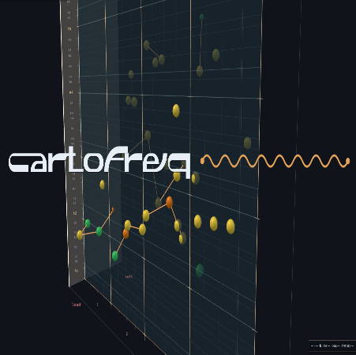

# Cartofreq

<p align="center">
  
</p>

Cartofreq is a microtonal sequencer in a three-dimensional space. Time runs left to right, pitch runs bottom to top, and brightness runs front to back. A phrase is four bars of 4/4, and it loops. Pitch is free between A1 (55 Hz) and A6 (1760 Hz). The readout names the nearest twelve-tone pitch, the cents offset, the bar, the beat, and the brightness.

There are two ways to use it:

- **The web demo** runs in a browser. It sounds with an oscillator or a loaded sample, and you can record what you hear. It's the fastest way to see what Cartofreq does, and to decide if it's something you want to use.
- **The desktop app** is the instrument. It plays your sample, sends the performance as MPE to any MPE-capable instrument, and routes its audio into a DAW. This is the version to use if you want to make something with it.

---

## Try the web demo

The web version is a browser demo of the sequencer. It runs entirely in the page, with a built-in oscillator or a sample you load. You can record the output and download it as an audio file.

It has the full editing experience: points, bends, columns, quantization, keyboard and MIDI input, and the MPE export. What it doesn't have is the desktop app's audio routing into a DAW or its virtual MIDI ports. For that, use the desktop app.

---

## The desktop app

The desktop app is the sampler. It loads one clip, pitch-shifts it with SoundTouch, and can also send the performance as MPE to an external instrument. On Linux it creates a virtual audio sink and source so the app's output lands in your DAW. On macOS and Windows it routes to a virtual audio driver you install (BlackHole or VB-Cable).

The desktop app is what you want if you're treating Cartofreq as an instrument rather than a demo.

---

## The score

Click the pitch plane to place a note. Drag a note to move it in time, pitch, and brightness. Hold Shift to keep the brightness still. Drag empty space to orbit the camera, and scroll to zoom.

Right-drag, or Control-drag, from a note to bend into a new one. New bends are linear or exponential, chosen in the transport. Double-click a bend to drop a point on it. In the sampler that point does not restart the clip: the same recording keeps playing, and the pitch moves through the new node. Double-click a note to edit its frequency, brightness, and velocity. In oscillator mode the editor also sets the waveform. Delete or Backspace removes the selected note.

Velocity is the onset. At 0 the note fades in. At 1 it strikes. Brightness is separate from that. It opens a lowpass and lifts the level a little. New clicks land on the brightness of the pitch plane.

Quantize moves every note onto the nearest quarter beat. Pitch, brightness, and bends stay as they are. Tempo runs from 40 to 240 BPM.

Space plays. Ctrl+S stops. The playhead loops the four bars.

---

## Columns

A column is one bar, the four beats between two bar lines. A ball sits above the middle of each bar. Click it to select that bar and open its menu: clear, copy, or paste.

Clear removes every note in the bar. Copy remembers the bar. Paste asks whether to overwrite the destination or add to what is already there. Pasted notes keep their place inside the bar. A note that sat a beat and a half into the copied bar lands a beat and a half into the bar you paste onto.

A bend that stays inside the bar is copied with its notes. A bend that runs into another bar is not. Its start is pasted as a single note. A note that is only the end of a bend from some other bar is left out.

---

## Playing in

Turn on the keyboard toggle and play the computer keys the way Ableton lays them out. A is C of the current octave. The white keys run A S D F G H J K L. The black keys are W E T Y U O P. Z and X shift the octave. A tap writes a single note. Hold a key and move to another, and the gesture continues as a bend. The end note is written when you let go.

MIDI in does the same. On the web, choose a port in the transport. Nothing is connected until you do. On the desktop, hardware inputs that are already connected are opened automatically, and Cartofreq MIDI In is a virtual input you can route into. Press Rescan MIDI if you plugged something in after launch. Ports whose names contain "Cartofreq" are skipped, so the app does not hear its own output.

Channel 1 pitch bend is ±2 semitones. Channels 2–16 use the MPE range, ±48 semitones. Brightness follows CC74.

---

## Sound

**Oscillator (web demo only).** Sine, triangle, sawtooth, or square. The wave chosen in the transport is given to new notes. Notes already in the score keep their own wave until you edit them.

**Sampler (web demo and desktop app).** One loaded clip, pitch-shifted with SoundTouch. The clip keeps its length. Only the pitch moves. Set the base frequency to the pitch the recording already is. A note at that frequency plays the clip as it was recorded. A note above or below it shifts the pitch. The default base is 440 Hz, and it is typed in. Cartofreq does not detect it from the file.

Loop sample repeats the recording inside a note, so a bend can outlast a short clip. Clips under 5 seconds start with this on. Turn it off and the file plays once, then the note goes quiet even if the bend is still going. Clips longer than 10 seconds are refused. With no sample loaded, the sampler is silent.

On the desktop, the volume slider is a monitor for the app's own output. Once that output is routed into a DAW, the DAW fader is a separate level.

---

## Desktop output

On the desktop, the transport has an output mode. It decides what the app does with the performance.

| Output | What happens |
|---|---|
| **Audio Out** | The sampler plays through the app's audio device. This is the default. |
| **MIDI Out** | MPE on the virtual port Cartofreq MPE. The sampler stays quiet. |
| **Both** | Sampler audio and MPE together. |

On launch the app sends an MPE zone of 15 member channels, and a ±48 semitone bend range on channels 2–16. Set the receiving instrument to ±48 as well, in case it ignores that message.

Virtual ports are created with RtMidi (`@julusian/midi`).

### Into a DAW

Hearing Cartofreq on your speakers needs no extra driver. The app plays through whatever output the computer is already using.

A DAW is different. Cartofreq does not switch its own output, and it does not select the DAW's input. The virtual cable shows up as an ordinary sound device. You choose it in two menus: one so Cartofreq plays into the cable, and one so the DAW listens to that cable. Set the desktop output mode to **Audio Out** or **Both** before you do this.

**Linux.** On launch the app creates a PulseAudio or PipeWire sink, `CartofreqOut`, and a source, `CartofreqIn`, that listens to it. The system default device is left alone. In the system sound settings, set Cartofreq's playback device to `CartofreqOut`. In the DAW, choose `CartofreqIn` as the input. If this process created those devices, they are removed when the app quits.

Those devices are created with `pactl`. PipeWire can already be running while `pactl` is still missing. The app then reports that audio out is unavailable and ends with `spawnSync pactl ENOENT`. That line is only the DAW cable. The speakers still play through the system output. Install the missing command and open the app again:

```
sudo apt install pulseaudio-utils
```

The desktop app is also silent until a sample is loaded. It does not play the web demo's oscillator. Use Load sample, set the base frequency to the pitch of that recording, then press Play.

**macOS, with BlackHole.** Install [BlackHole 2ch](https://existential.audio/blackhole/). Open the package and follow the installer. If macOS blocks the driver, allow it under System Settings → Privacy & Security, then restart if it asks.

BlackHole 2ch then shows up as both an output and an input. Cartofreq has no audio-device menu of its own, so it follows the Mac's current output.

To keep hearing your speakers and also feed the DAW:

1. Open Audio MIDI Setup (Applications → Utilities).
2. Click the + button and choose Create Multi-Output Device.
3. Check your speakers or headphones, and check BlackHole 2ch. Leave the speakers as the main device.
4. In System Settings → Sound → Output, choose that Multi-Output Device.

Every app, including Cartofreq, then plays through the speakers and through BlackHole. In the DAW's audio settings, set the input device to BlackHole 2ch, arm a track, and turn monitoring on. That track is Cartofreq.

If you would rather hear Cartofreq only inside the DAW, skip the multi-output device and set System Settings → Sound → Output to BlackHole 2ch. Other Mac audio goes there too, until you switch the output back.

**Windows, with VB-Cable.** Install [VB-CABLE](https://vb-audio.com/Cable/). Unzip it, run the setup program as administrator, and reboot when it asks. After the reboot Windows has two new devices, and the names run opposite to what they sound like:

- **CABLE Input** is the playback end. Programs play into it.
- **CABLE Output** is the recording end. The DAW listens to it.

Point only Cartofreq at the cable, so the rest of Windows stays on your speakers.

1. Open Settings → System → Sound → Volume mixer. On Windows 10 this is Settings → System → Sound → App volume and device preferences.
2. Find Cartofreq and set its output device to CABLE Input. Leave the system default output on your speakers.
3. In the DAW's audio settings, set the input device to CABLE Output.
4. Arm a track and turn monitoring on.

The desktop volume slider is the level going into the cable. The DAW fader is the level after that.

**Windows virtual MIDI.** Windows cannot create a MIDI port by itself. Install [loopMIDI](https://www.tobias-erichsen.de/software/loopmidi.html) and leave it running in the system tray.

1. In loopMIDI, click + to add a port.
2. Rename that port to `Cartofreq MPE`. The name has to contain those words. Cartofreq looks for them and connects to that port.
3. Start Cartofreq after the port exists. If the app was already open, quit and open it again.
4. In the DAW or the instrument, choose Cartofreq MPE as a MIDI input.
5. Set that instrument's MPE bend range to ±48 semitones.

A USB keyboard does not need loopMIDI. Plug it in before launch, or press Rescan MIDI. For a software keyboard on the same machine, add a second loopMIDI port named `Cartofreq MIDI In`, send the keyboard there, and Cartofreq opens it as an input.

Linux and macOS do not need loopMIDI. While the desktop app is open, Cartofreq MPE and Cartofreq MIDI In appear on their own. You still choose Cartofreq MPE as the input in the receiving instrument.

---

## Export

The MPE button writes a `.mid` file for another instrument. Pitch is carried as per-note bend, glides become bend curves, brightness is CC74, and a change in velocity along a bend is CC11. The file is one track per member channel. The receiving instrument needs MPE, with its member-channel bend range set to ±48 semitones. A bend wider than that saturates. Wave type is not in the file. The instrument on the other end makes the sound.

On the web demo, Record captures what the browser is playing. The desktop app does not record. Its audio is meant to land in the DAW.

---

## Run

Node.js and npm.

```
npm install
npm run dev:web
```

The web demo is served at http://127.0.0.1:5173/.

The desktop app:

```
npm run dev
```

That command passes `--no-sandbox`. Electron's setuid sandbox helper is not usable from a local `node_modules` checkout, and the app aborts without the flag.

Packaged installers:

```
npm run dist:linux   # AppImage
npm run dist:mac     # dmg
npm run dist:win     # nsis
```

They are written to `release/`. Each one is named `cartofreq`: `cartofreq.AppImage`, `cartofreq.dmg`, and `cartofreq.exe`. The installed program is `cartofreq` as well. The window title is Cartofreq. The picture at the top of this file is the app icon.

**Linux.** The file to open is `release/cartofreq.AppImage`.

A double-click of a build from before this fix exits immediately. Electron finds `chrome-sandbox` inside the package, that helper is not setuid root, and the process aborts before a window exists. The file manager does not show the error. Current packages start with `--no-sandbox`, so opening the AppImage or `release/linux-unpacked/cartofreq` reaches the window.

The AppImage also needs FUSE 2 (`libfuse.so.2`). Ubuntu 24.04 ships FUSE 3 without it. Without the library the file exits the same way, before a window. On Ubuntu 24.04 and later:

```
sudo apt install libfuse2t64
```

On Ubuntu 22.04 the package is `libfuse2`.

`npm run dist:linux` also writes an unpacked app that does not need FUSE:

```
./release/linux-unpacked/cartofreq
```

If you only have an AppImage and cannot install FUSE, this starts that file. The filename includes the version.

```
APPIMAGE_EXTRACT_AND_RUN=1 ./release/cartofreq.AppImage
```

---

## Limitations

- SoundTouch is less clean when the pitch ratio leaves the range of about 0.5–2. Ratios are clamped to 0.1–8.
- Notes far from the sample's base frequency can trail the grid by a fraction of a beat. The looping phrase is comfortable with that. Playing live from the keyboard or from MIDI feels the delay.
- One sample is loaded at a time.
- A bend that runs past a clip, with Loop sample off, ends when the clip ends.
- The sampler keeps 8 voices. The oscillator keeps 16. Each sampler voice is an AudioWorklet.
- Linux DAW routing needs `pactl`, from the `pulseaudio-utils` package, and PipeWire or PulseAudio running. Without `pactl` the speakers still play, and CartofreqOut and CartofreqIn are not created.
- The macOS and Windows virtual-audio drivers are not bundled.
- Windows virtual MIDI needs loopMIDI.
